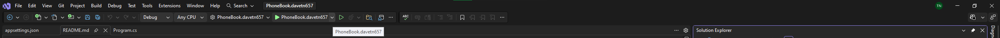
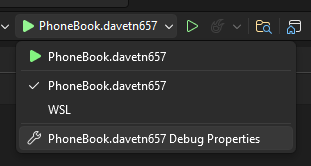
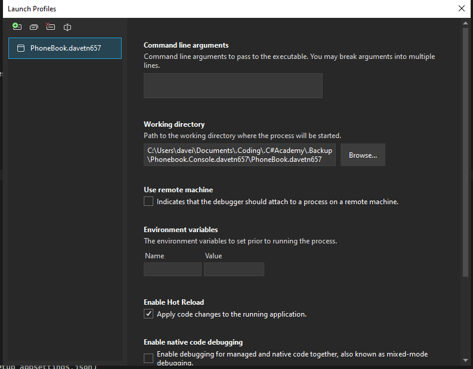

# Phonebook Application

## Overview

A console based application that keeps track of user contacts (Email and Phone numbers).

Created for the C# Academy project based learning

## Requirements

- Users should be able to record either a phone number or email for contacts
- Users should be able to Add, Delete, Update, and Read from a database
- Must use Entity Framework ORM
- Code needs to contain a base Contact class with at least a name, email, and phone number properties
- Emails and Phone numbers should be validated
- Should handle errors so the app doesn't crash
- Code-first approach
- Allow the user to seperate contacts into categories
- Can send emails
- Create a units test project

## Setup

Setup working directory:

- Click the arrow dropdown beside the run button on Visual Studio

- Click "PhoneBook.davetn657 Debug Properties"

- Click Browse and change the working directory to your PhoneBook.davetn657 file path

Sending an Email:

- Choose a contacct that you would like to email
- Choose the "Send Email" Option
- Enter the email and password of the email you would like to use to send an email with (Currently only works with gmail)
- Enter email content then send!

## Technologies

- C#
- SQLite
- Entity Framework
- Spectre.Console

## Looking back

### Positives

- After I setup and got used to EF it felt much more streamlined compared to typing out Sql queries
- First time creating a unit test project with xunit, I think I covered most of the basic functions

### Negatives

- Had trouble setting up Entity Framework
- I had to keep looking back at previous projects to findout how I did things before (e.g. how to setup appsettings.json)