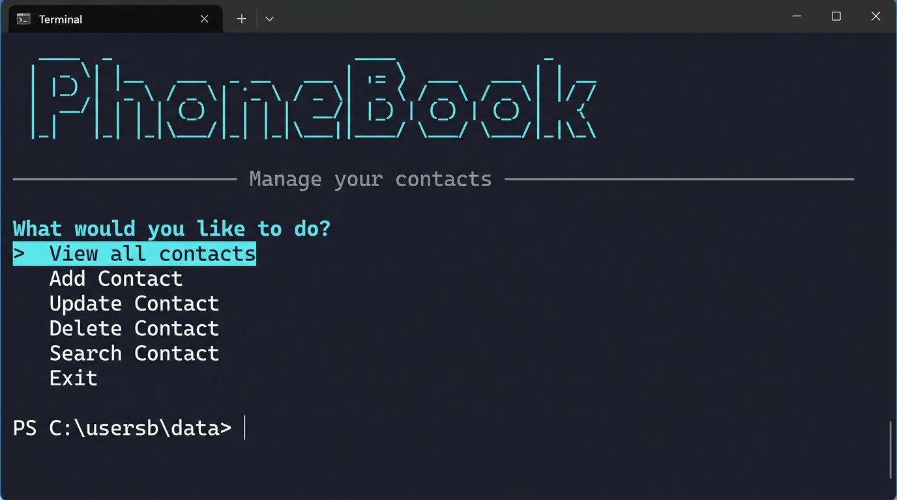
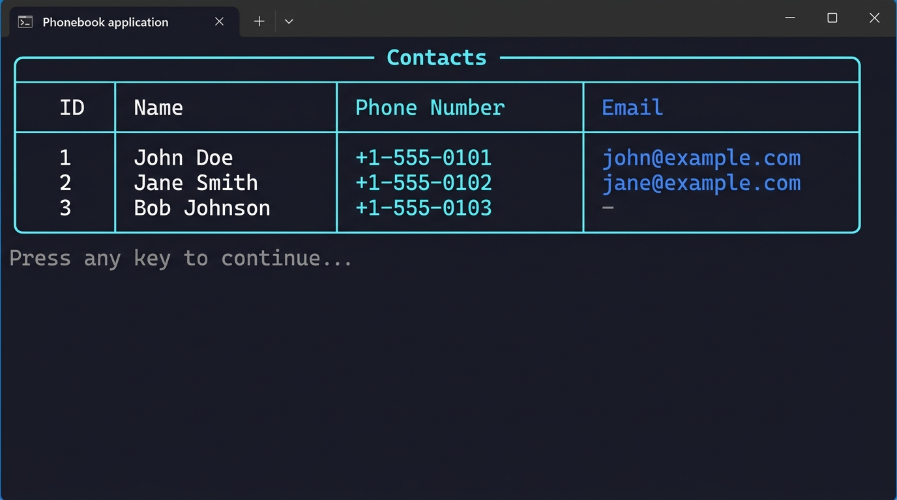

# PhoneBook

A modern console-based phonebook application built with C# and .NET. Manage your contacts with a beautiful terminal UI powered by [Spectre.Console](https://spectreconsole.net/).




---

## Features

- **View all contacts** — Browse your contacts in a clean, formatted table
- **Add contacts** — Save new contacts with name, phone number, and optional email
- **Update contacts** — Edit existing contact details with pre-filled defaults
- **Delete contacts** — Remove contacts with a confirmation prompt
- **Search contacts** — Find contacts by name with fuzzy matching
- **Input validation** — Phone numbers and emails are validated on entry
- **Seed data** — Comes pre-loaded with sample contacts to get started




---

## Tech Stack

| Technology | Purpose |
|---|---|
| **.NET 10** | Runtime & SDK |
| **C# 13** | Language |
| **Entity Framework Core** | ORM & database migrations |
| **SQLite** | Lightweight local database |
| **Spectre.Console** | Rich terminal UI (tables, prompts, figlet text) |

---

## Project Structure

```
PhoneBook/
├── Data/
│   └── PhoneBookContext.cs      # EF Core DbContext with seed data
├── Helpers/
│   └── Validation.cs            # Input validation (phone, email, name)
├── Migrations/                  # EF Core database migrations
├── Models/
│   ├── Contact.cs               # Contact entity
│   └── Category.cs              # Category entity
├── Services/
│   └── ContactService.cs        # CRUD operations for contacts
├── UI/
│   └── UserInterface.cs         # Spectre.Console interactive menu
├── Program.cs                   # Entry point
└── PhoneBook.csproj             # Project file & dependencies
```

---

## Getting Started

### Prerequisites

- [.NET 10 SDK](https://dotnet.microsoft.com/download) or later

### Run the app

```bash
# Clone the repo
git clone https://github.com/your-username/CodeReviews.Console.Phonebook.git
cd CodeReviews.Console.Phonebook/PhoneBook

# Run
dotnet run
```

The database is created automatically on first run via EF Core migrations — no extra setup needed.

### Build only

```bash
dotnet build
```

---

## How It Works

1. **Startup** — The app applies any pending EF Core migrations, creating the SQLite database (`PhoneBook.db`) if it doesn't exist.
2. **Main menu** — A Spectre.Console selection prompt lets you pick an action using arrow keys.
3. **CRUD operations** — All contact data is persisted to the local SQLite database through Entity Framework Core.
4. **Validation** — Phone numbers must match `+?[\d\s\-()]{7,20}`, emails are validated with a standard regex, and names must be 1–100 characters.

---

## License

This project is part of [The C# Academy](https://www.thecsharpacademy.com/) code review challenges.
